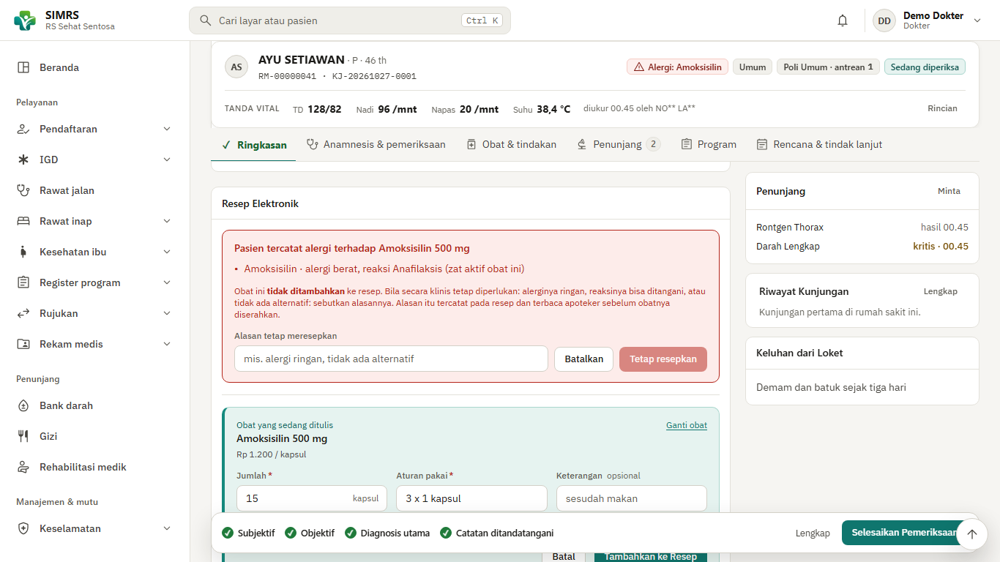
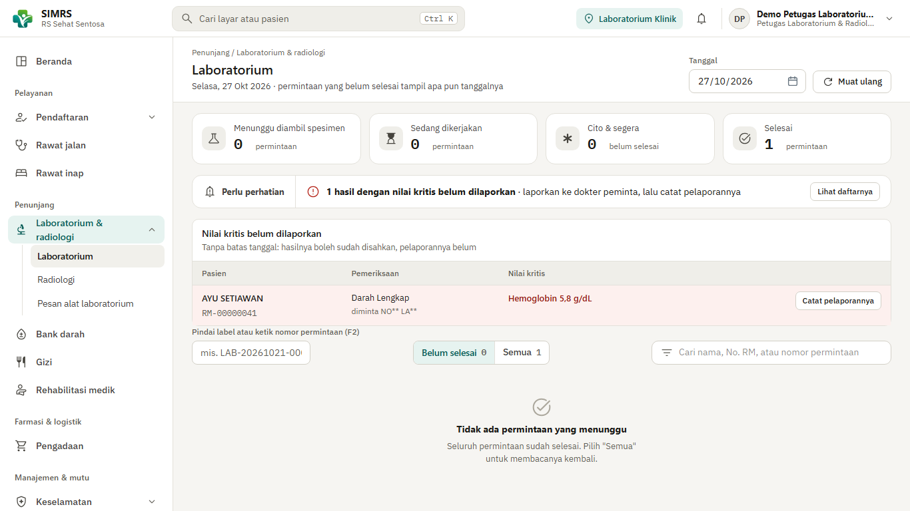
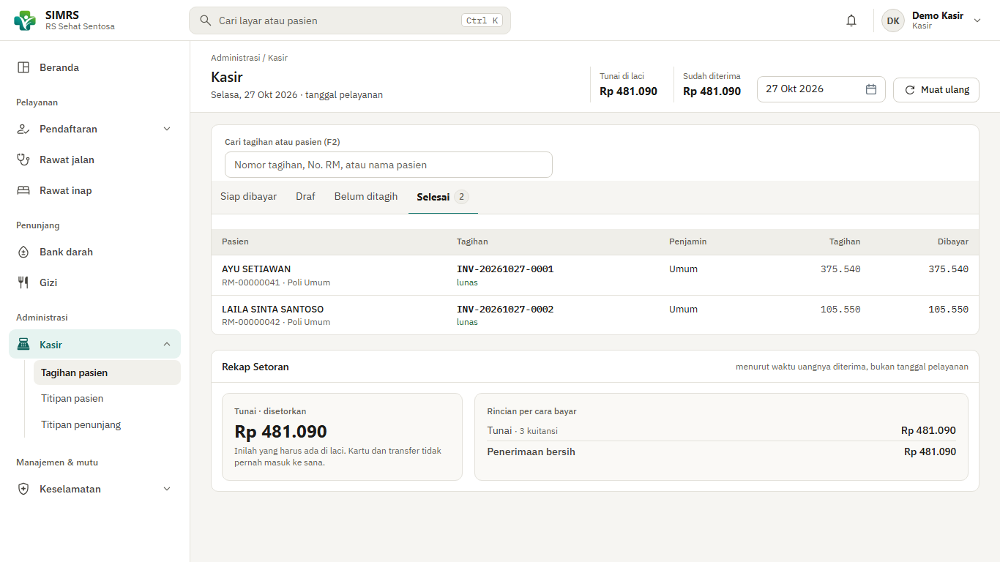
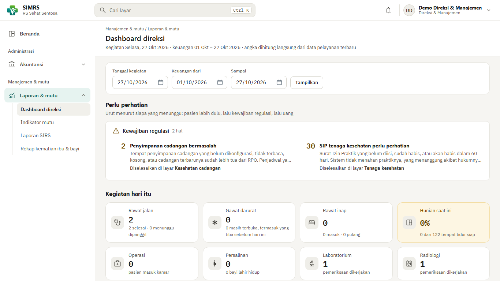
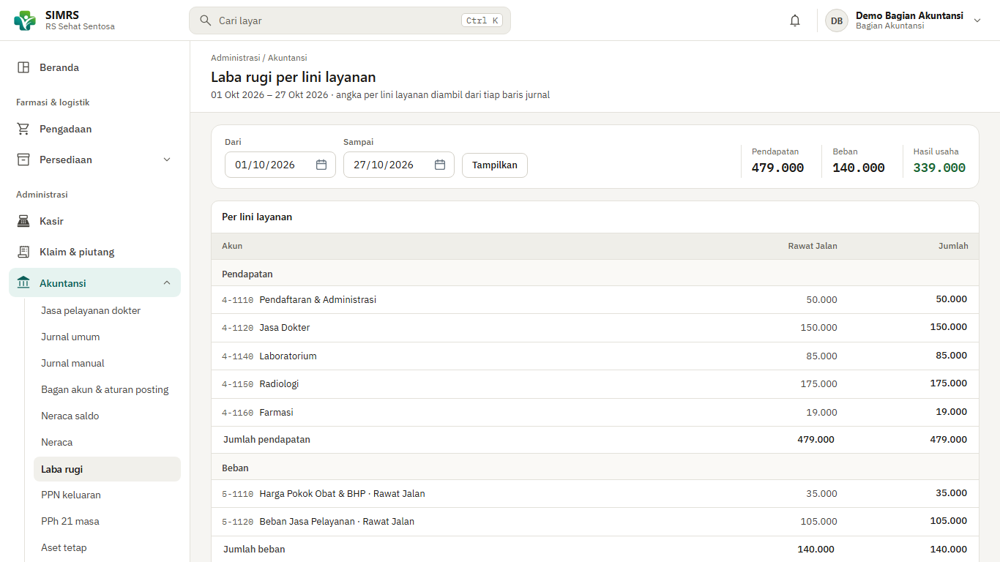
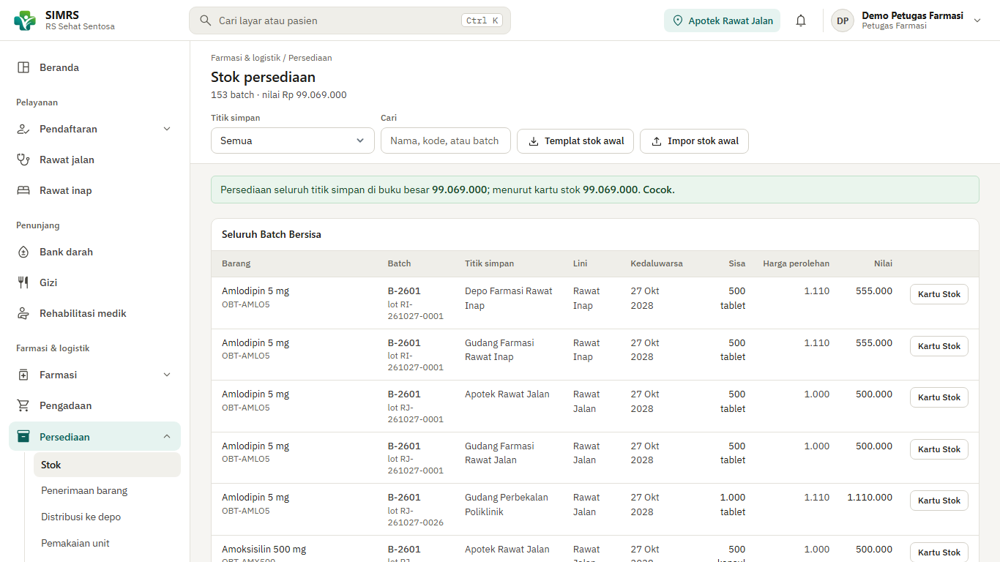
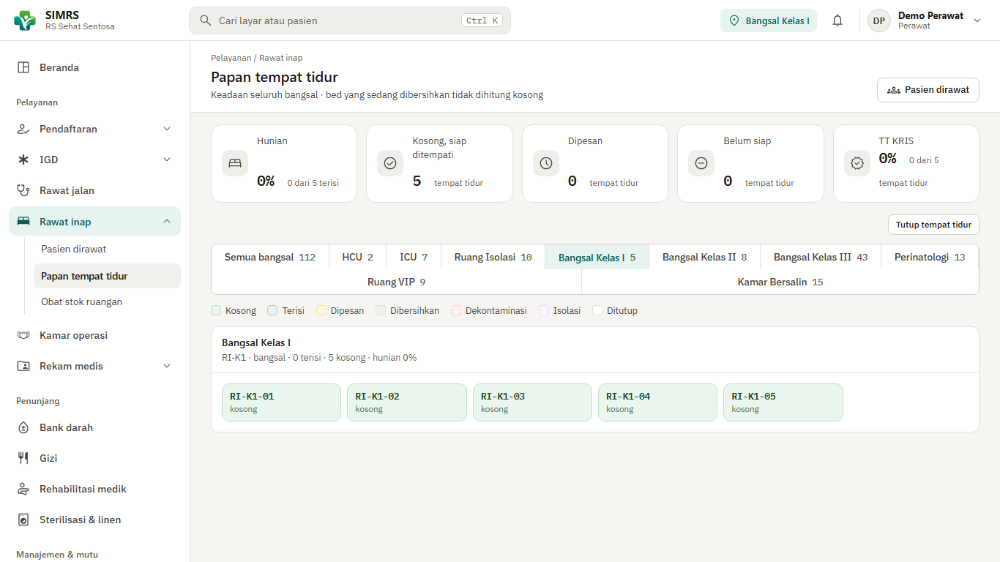
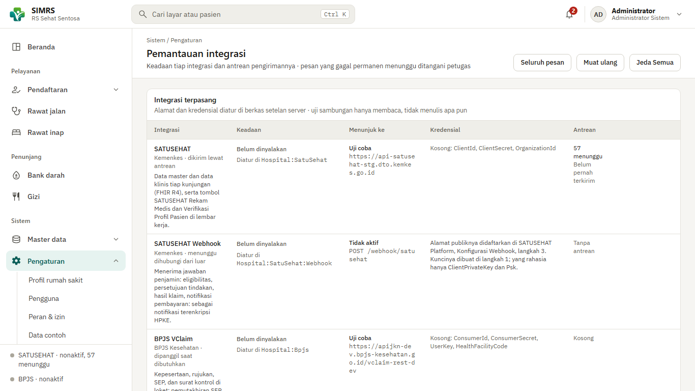
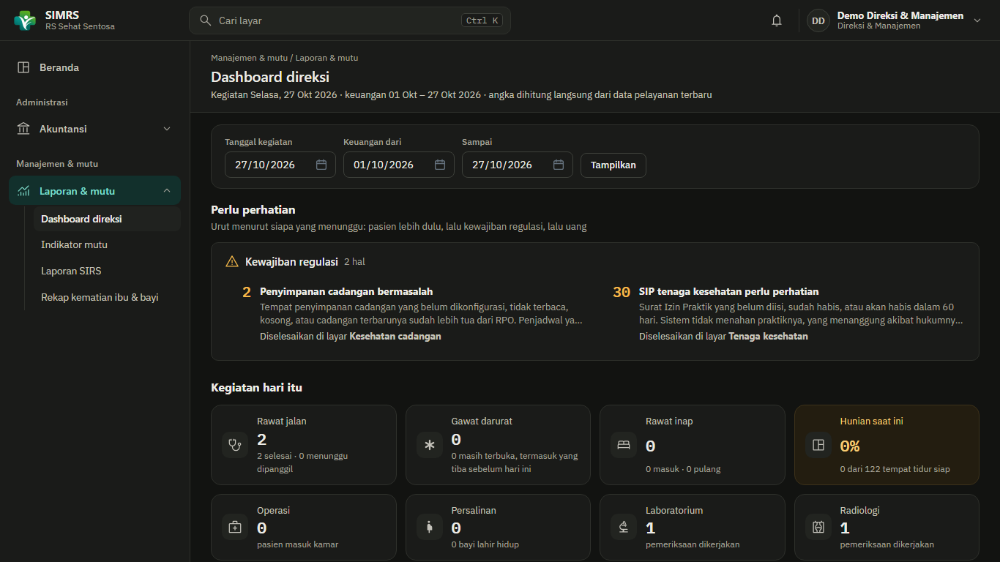

<div align="center">

# SIMRS

**Sistem informasi rumah sakit, dari loket pendaftaran sampai buku besar.**<br>
Dibangun untuk RS umum kelas C di Indonesia, dengan SATUSEHAT dan BPJS tersambung sejak awal.


[Coba sendiri](#coba-sendiri) ·
[Fitur](#yang-sudah-didukung) ·
[Integrasi](#integrasi-nasional) ·
[Video](#video-skenario) ·
[Beri masukan](#memberi-masukan) ·
[Lisensi](#lisensi-dan-pihak-ketiga)



</div>

> *SIMRS is a hospital information system for mid-size Indonesian hospitals: EMR, pharmacy,
> billing, accounting, with SATUSEHAT (HL7 FHIR R4) and BPJS integration. This repository
> distributes free trial builds for Windows and Linux. Documentation is in Indonesian.*

> [!WARNING]
> **Ini versi uji coba, bukan untuk pelayanan pasien sungguhan.** Jangan memasukkan data
> pasien sungguhan. Semua data di sini karangan. Lisensinya melarang pemakaian klinis
> sampai ada kesepakatan terpisah ([butir 8](LICENSE.txt)).

## Apa ini

SIMRS adalah aplikasi web yang berjalan di jaringan lokal rumah sakit. Satu sistem memegang
pendaftaran, rekam medis elektronik, penunjang, farmasi, logistik, kasir, klaim, akuntansi,
dan kepegawaian. Datanya tersimpan di PostgreSQL milik Anda sendiri.

Sasaran rancangannya **rumah sakit umum kelas C, swasta, sekitar 120 tempat tidur, bekerja
sama dengan BPJS**. Aturan yang membentuknya: UU 44/2009 dan Permenkes 82/2013 (SIMRS
wajib), Permenkes 24/2022 (rekam medis elektronik), serta SE Menkes 1030/2023 (integrasi
ke SATUSEHAT).

### Kenapa layak dicoba

| | |
|---|---|
| **Satu sistem, satu basis data** | Biaya yang lahir dari pelayanan masuk jurnal lewat aturan posting yang bisa diaudit. Tidak ada input ulang antara kasir dan akuntansi |
| **Integrasi bukan tempelan** | SATUSEHAT dan BPJS berangkat lewat antrean di latar belakang. Pelayanan tidak menunggu server luar, dan tetap jalan saat internet putus |
| **Keselamatan pasien di dalam alur** | Peringatan alergi menahan peresepan. Darah tanpa uji silang serasi tidak keluar. Nilai kritis laboratorium menuntut tindak lanjut |
| **Jejak audit dan hak akses** | Siapa membuka data apa tercatat, termasuk yang hanya membaca. Izin diatur per peran. Akun administrator tidak bisa mengerjakan pelayanan, itu disengaja |
| **Berjalan di server Anda** | Tidak ada data yang dikirim ke pembuatnya. Sistem baru menghubungi pihak luar bila Anda sendiri menyalakan integrasinya |
| **Dibuktikan, bukan diklaim** | Lihat [bagian bukti](#bagaimana-kami-membuktikannya): tur otomatis di peramban sungguhan dan pengujian terhadap gerbang sandbox Kemenkes |

## Tangkapan layar

Semua data pada gambar adalah karangan. Pasien dan nomor rekam medisnya dibuat acak,
dokternya tenaga kesehatan uji milik Kemenkes (namanya tersamar, begitulah sandbox menyimpannya).

<table>
<tr>
<td width="50%"><br><sub><b>Nilai kritis.</b> Hasil kritis yang belum dilaporkan ke dokter peminta tetap menyala sampai dicatat.</sub></td>
<td width="50%"><br><sub><b>Kasir.</b> Tagihan per pasien dan rekap setoran.</sub></td>
</tr>
<tr>
<td><br><sub><b>Dasbor direksi.</b> Kegiatan hari ini dan hal yang perlu perhatian.</sub></td>
<td><br><sub><b>Laba rugi per lini layanan.</b> Rawat jalan, rawat inap, dan gawat darurat dibaca terpisah.</sub></td>
</tr>
<tr>
<td><br><sub><b>Stok per batch.</b> Kartu stok dicocokkan dengan buku besar.</sub></td>
<td><br><sub><b>Papan tempat tidur.</b> Keadaan tiap bangsal dan kelas.</sub></td>
</tr>
<tr>
<td><br><sub><b>Pemantauan integrasi.</b> Status, antrean, dan uji sambungan tiap layanan luar.</sub></td>
<td><br><sub><b>Tema gelap.</b> Tersedia tema terang dan gelap.</sub></td>
</tr>
</table>

## Yang sudah didukung

Lebih dari 200 layar, dikelompokkan dalam 25 modul di enam bagian menu. Menu hanya
menampilkan layar yang boleh dibuka peran Anda.

| Bagian | Yang bisa dikerjakan |
|---|---|
| **Pelayanan** | **Pendaftaran** (pasien baru, penggabungan berkas ganda, kontrol ulang, rencana rawat inap, SEP BPJS). **Antrean** poliklinik dan papan ruang tunggu. **IGD** (triase, pasien tak dikenal, keputusan dokter). **Rawat inap** (CPPT, papan tempat tidur, obat stok ruangan). **Kamar operasi**, **kamar bersalin**, asuhan kehamilan dan nifas. **Register** TB, HIV, dan penyakit lain. **Rujukan** masuk dan keluar. **Rekam medis**: SOAP, diagnosis ICD-10, alergi, resume medis, adendum, lampiran pindaian, persetujuan tindakan, koding, sertifikat kematian |
| **Penunjang** | **Laboratorium** (spesimen, nilai rujukan per kelompok umur, nilai kritis, antarmuka alat). **Radiologi** (worklist DICOM). **Bank darah**. **Gizi** (asuhan gizi terstandar). **Rehabilitasi medik**. **Sterilisasi pusat** dan **binatu** |
| **Farmasi dan logistik** | **Apotek**: kaji resep, racikan, alat kesehatan, penjualan bebas, stok dilacak per batch dan diambil menurut tanggal kedaluwarsa terdekat. **Pengadaan**: permintaan, pesanan, persetujuan berjenjang, utang usaha, retur. **Persediaan**: penerimaan, distribusi ke depo, stok opname, penelusuran batch |
| **Administrasi** | **Kasir**: tagihan, titipan pasien, titipan penunjang. **Klaim dan piutang**: klaim penjamin, INA-CBG, pelunasan, umur piutang. **Akuntansi**: buku besar menurut PSAK, jurnal otomatis dan manual, neraca saldo, neraca, laba rugi per lini, PPN keluaran, PPh 21, aset tetap dan penyusutan, kunci buku, jasa pelayanan dokter. **Kepegawaian**: berkas pegawai, skala gaji, daftar gaji, THR, PPh 21 beserta berkas untuk Coretax |
| **Manajemen dan mutu** | Dasbor direksi, indikator mutu, laporan SIRS (RL), insiden keselamatan pasien, pencegahan infeksi (PPI), kecelakaan kerja (K3RS) |
| **Sistem** | Master data (tenaga kesehatan, jadwal praktik, layanan dan tarif, katalog obat dan barang, pemasok, penjamin, formulir asesmen, dan lainnya). Pengguna, peran dan izin, jejak audit, pemantauan integrasi, kesehatan cadangan, masa simpan arsip |

Tampilan responsif, jadi visite dokter bisa memakai tablet. Aplikasi seluler terpisah
sengaja tidak dibuat.

## Integrasi nasional

Dua hal berlaku untuk semuanya:

- **Bawaannya mati.** Integrasi baru menyala bila Anda mengisi kredensialnya sendiri.
  Kredensial itu diterbitkan Kemenkes dan BPJS, bukan oleh paket ini.
- **Sistem berjalan penuh tanpanya.** Pengiriman ke luar selalu lewat antrean di latar
  belakang. Kegagalan di sisi luar tidak pernah membatalkan kunjungan.

Kolom *Keadaan* menjawab satu pertanyaan: **seberapa jauh integrasinya sudah dibuktikan.**

| Integrasi | Fungsinya | Keadaan (27 Okt 2026) |
|---|---|---|
| **SATUSEHAT** (HL7 FHIR R4) | Data master dan data klinis tiap kunjungan, resume medis, tagihan | **Terbukti di sandbox Kemenkes.** Produksi menunggu registrasi sistem rekam medis ke Kemenkes dan kredensial produksi |
| **SATUSEHAT Webhook** | Menerima jawaban penjamin (eligibilitas, persetujuan, hasil klaim) | Penerima dan pembuka pesan terenkripsi (HPKE) ada, diuji dengan vektor RFC 9180. **Kiriman sungguhan dari Kemenkes belum pernah terlihat** |
| **DICOM Router Kemenkes** | Menerbitkan `ImagingStudy` dari citra modalitas | **Terbukti di staging** (26 Sep 2026). Router dipasang terpisah |
| **BPJS VClaim** | Kepesertaan, rujukan, SEP, surat kontrol, rencana kontrol, PRB | Dibangun menurut dokumentasi resmi, alamatnya diadu ke gerbang BPJS, diuji dengan simulator. **Belum dengan kredensial rumah sakit sungguhan** |
| **BPJS Antrean Online** | Nomor antrean dan waktu tiap tahap pelayanan | Sama dengan VClaim. Sisi masuk (Mobile JKN memanggil rumah sakit) **belum dibuat** |
| **BPJS Aplicares** | Ketersediaan tempat tidur untuk Mobile JKN | Sama dengan VClaim |
| **BPJS i-Care JKN** | Riwayat pelayanan peserta di layar dokter | Dibangun, alamat endpoint-nya belum terbukti |
| **E-Klaim** (INA-CBG) | Kode CBG dan tarif paket dari aplikasi E-Klaim di jaringan rumah sakit | Diuji dengan simulator. **Belum dengan instalasi E-Klaim sungguhan.** Sistem ini tidak pernah menggrup sendiri |
| **SISRUTE** | Rujukan antar-fasilitas | Diuji dengan simulator menurut dokumentasi resmi |
| **SIRANAP** | Ketersediaan tempat tidur per kelas | Diuji dengan simulator. **Protokolnya belum diverifikasi ke API sungguhan** |
| **Alat laboratorium** (HL7 v2) | Hasil alat masuk sebagai draf lembar hasil | Diuji dengan simulator alat |
| **Worklist radiologi** (DICOM) | Jadwal pemeriksaan ke modalitas | Diuji dengan simulator modalitas |

Siapa menerbitkan kredensial apa, ada di [PIHAK-KETIGA.md](PIHAK-KETIGA.md#4-layanan-luar-yang-butuh-izin-penyelenggaranya).

## Bagaimana kami membuktikannya

Angka di bawah diukur pada **27 Oktober 2026** dan akan basi. Tanggalnya sengaja ditulis.

| Yang diukur | Hasil | Cara |
|---|---|---|
| Langkah interoperabilitas SATUSEHAT yang jadi tugas sistem rumah sakit | **499 dari 526** terbukti diterima gerbang sandbox. 27 belum | Daftar langkah resmi Kemenkes per modul (34 modul), diadu mesin dengan bukti dari gerbang. 61 langkah lain dikerjakan pihak lain |
| Jenis pesan yang pernah diterima gerbang | 119 | Berkas bukti ditulis mesin dari antrean sesudah rantai dijalankan |
| Kotak transaksi di dasbor sandbox SATUSEHAT | **19 dari 19** terisi (9 Okt 2026) | Tangkapan dasbor sesudah seluruh skenario dijalankan dari pemasangan bersih |
| Tur otomatis | **342 tes** di 27 berkas | Peramban sungguhan yang menekan tombol seperti petugas: tes yang hijau berarti tombolnya benar-benar bekerja |

Satu aturan kami: **tes hijau bukan bukti integrasi.** Yang dihitung adalah muatan yang
benar-benar diterima gerbang, dibaca kembali dari salinannya di sana.

## Coba sendiri

Anda butuh **dua hal** di komputer: ASP.NET Core Runtime 10 dan PostgreSQL 16 atau 17.
Aplikasinya sendiri tidak memasang apa pun ke sistem Anda. Ia hanya folder yang dijalankan.

**1. Pasang prasyaratnya** (lewati bila sudah ada)

<table>
<tr><th>Windows 10/11 (PowerShell)</th><th>Ubuntu 24.04 (juga di WSL)</th></tr>
<tr><td>

```powershell
winget install -e --id Microsoft.DotNet.AspNetCore.10
winget install -e -i --id PostgreSQL.PostgreSQL.17
```

Catat sandi pengguna `postgres` yang Anda tetapkan. Buka ulang terminal sesudahnya.

</td><td>

```bash
sudo apt update
sudo apt install -y aspnetcore-runtime-10.0 postgresql unzip
sudo -u postgres psql -c \
  "ALTER USER postgres PASSWORD 'sandi-pilihan-anda'"
```

Distribusi lain: pasang dua komponen itu menurut petunjuknya.

</td></tr>
</table>

**2. Unduh paketnya** dari halaman [Releases](https://github.com/team-basis/simrs/releases)
dan bongkar ke folder biasa. Satu zip yang sama dipakai di Windows dan Linux.

**3. Jalankan sekali** (`jalankan.bat` di Windows, `bash jalankan.sh` di Linux). Ia membuat
`setelan.json` lalu berhenti.

**4. Isi dua hal di `setelan.json`**: sandi PostgreSQL Anda, dan sandi administrator pertama
(minimal 10 karakter).

**5. Jalankan lagi.** Start pertama memakan beberapa menit karena aplikasi membuat basis
data dan menanam katalog. Selesai bila konsol menulis `Now listening on: http://localhost:5000`.

**6. Buka <http://localhost:5000>**, masuk sebagai `admin`, ikuti ganti sandi dan pasang
aplikasi autentikator. Lalu buka **Pengaturan → Data contoh** dan tekan **Isi Data Contoh**.
Dalam kira-kira satu menit terisi poliklinik, dokter, jadwal, stok, 40 pasien karangan, dan
satu akun per peran. Layar itu menampilkan daftar akunnya.

Panduan lengkapnya, termasuk pemecahan masalah: **[docs/PANDUAN.md](docs/PANDUAN.md)**
(juga ada di dalam zip).

### Yang perlu diketahui

- **Akun demo bersandi sama dan sandinya tertulis di layar.** Jangan membuka aplikasi ke
  jaringan yang tidak Anda percayai.
- **Dari komputer lain**, aplikasi menolak HTTP dan meminta HTTPS. Isi rekam medis tidak
  boleh lewat jaringan tanpa enkripsi. Di komputer yang sama, `localhost` tidak butuh sertifikat.
- **Zona waktu** bawaannya WIB. Bila komputer Anda berzona lain, aplikasi berhenti dengan
  pesan yang jelas. Ubah `TimeZone` di `setelan.json` (`Asia/Makassar` untuk WITA, `Asia/Jayapura` untuk WIT).
- **Memperbarui**: bongkar zip baru ke folder baru, salin `setelan.json`, jalankan. Basis data
  dimutakhirkan otomatis dan **tidak bisa diturunkan**, jadi buat cadangan lebih dulu.
- **Yang sudah dicoba**: aplikasinya berjalan di Windows 11 (tempat ia dikembangkan) dan di
  Linux. Langkah Ubuntu 24.04 di atas sudah dijalankan dari distro bersih sampai data contoh
  tertanam. Perintah `winget` baru diperiksa terhadap katalognya. macOS **belum diuji**.

## Rilis

Tiap rilis di halaman [Releases](https://github.com/team-basis/simrs/releases) memuat:

| Berkas | Isinya |
|---|---|
| `simrs-<versi>.zip` | Aplikasi, peluncur Windows dan Linux, contoh setelan, panduan, lisensi, daftar komponen pihak ketiga |
| `SHA256SUMS.txt` | Sidik jari berkas untuk memeriksa unduhan Anda |
| Catatan rilis | Yang berubah, batasan versi itu, dan tautan video skenarionya |

Periksa unduhan Anda:

```powershell
# Windows
(Get-FileHash simrs-<versi>.zip -Algorithm SHA256).Hash
```
```bash
# Linux
sha256sum -c SHA256SUMS.txt
```

Versi tertulis di bawah layar masuk dan di `VERSI.txt`. Sebutkan versi itu saat melapor.
Seluruh rilis ditandai **preview**: sesuatu bisa berubah antarversi.

## Video skenario

Video menunjukkan alur kerja dari pemasangan sampai kuitansi, dengan narasi. Bahannya
skenario yang sama dengan yang bisa Anda jalankan sendiri. **Video sedang direkam.**
Tautannya akan ditambahkan di tabel ini dan di catatan rilis begitu tayang.

| Video | Isinya | Keadaan |
|---|---|---|
| **S0** | Dari paket yang baru diunduh sampai aplikasi siap dipakai | Sedang direkam |
| **S1** | Rawat jalan poli umum dengan dua pasien: pendaftaran, pemeriksaan, penahanan alergi, laboratorium, radiologi, farmasi, kasir | Sedang direkam |
| **S2** | IGD: pasien tak dikenal, obat dari troli, pulang | Menyusul |
| **S3** | IGD ke rawat inap ke operasi ke pulang | Menyusul |

Video **tidak membuktikan pengiriman ke Kemenkes**. Integrasi dimatikan pada rekamannya.

## Memberi masukan

Kode sumber tidak dibuka, jadi yang kami minta dari Anda adalah **masukan**. Itu yang
menentukan ke mana sistem ini berkembang.

| Anda ingin | Pakai |
|---|---|
| Melaporkan yang **rusak** | [Laporan galat](https://github.com/team-basis/simrs/issues/new?template=bug.yml) |
| Melaporkan yang **membingungkan** atau terlalu panjang | [Pengalaman mencoba](https://github.com/team-basis/simrs/issues/new?template=pengalaman-uji.yml) |
| Mengusulkan **fitur atau perubahan alur** | [Saran](https://github.com/team-basis/simrs/issues/new?template=saran.yml) |
| **Bertanya**, berdiskusi, berbagi cerita | [Discussions](https://github.com/team-basis/simrs/discussions) |
| Melaporkan **kerentanan** | [Kebijakan keamanan](SECURITY.md), jangan di issue publik |

**Yang paling kami cari dari orang rumah sakit**: alur yang tidak sesuai kenyataan di unit
Anda, istilah yang tidak dipakai di tempat Anda, laporan yang Anda butuhkan, dan aturan
regulasi yang kami tafsirkan keliru. Sebutkan **peran Anda**. Layar yang sama terlihat
berbeda dari tiap meja.

**Jangan pernah melampirkan** data pasien sungguhan, isi `setelan.json`, sandi, atau
token. Aturan lengkapnya di [CONTRIBUTING.md](CONTRIBUTING.md).

## Lisensi dan pihak ketiga

### Lisensi SIMRS: uji coba

Hak cipta © 2026 Basis. Teks lengkap: **[LICENSE.txt](LICENSE.txt)**.

| Boleh | Tidak boleh |
|---|---|
| Memasang dan menjalankan di komputer Anda atau organisasi Anda, gratis, untuk mencoba dan menilai | Memakainya untuk pelayanan pasien sungguhan atau memasukkan data pasien sungguhan |
| Membagikan paket **utuh dan tidak diubah** beserta lisensinya | Menjual, menyewakan, atau menarik biaya atas paket ini |
| Mengirim masukan. Kami boleh memakainya tanpa kewajiban apa pun kepada Anda | Mengubah, membongkar (dekompilasi), atau membuat karya turunan. Kode sumber tidak termasuk dalam lisensi |

Pemakaian untuk pelayanan sungguhan memerlukan **kesepakatan tersendiri**. Hubungi
basisapp.admin@gmail.com. Perangkat lunak ini diberikan apa adanya, tanpa jaminan.

### Komponen dan layanan pihak lain

SIMRS memakai pustaka sumber terbuka, menanam katalog terminologi milik penerbit lain, dan
tersambung ke layanan yang butuh izin penyelenggaranya. Semuanya ada di
**[PIHAK-KETIGA.md](PIHAK-KETIGA.md)**. Ringkasnya:

| Hal | Ringkasan |
|---|---|
| **Pustaka** | Entity Framework Core, Npgsql, Firely SDK (FHIR), ClosedXML, QRCoder, Tabulator, Tailwind CSS, dan lainnya. Lisensinya MIT, Apache-2.0, BSD-3-Clause, PostgreSQL License, atau SIL OFL. Tiap pustaka tetap tunduk pada lisensinya sendiri |
| **Yang Anda pasang sendiri** | ASP.NET Core Runtime 10 (MIT) dan PostgreSQL (PostgreSQL License). Tidak ikut dalam paket |
| **Terminologi** | ICD-10, ICD-9-CM, LOINC, SNOMED CT (sebagian kecil), KFA, KPTL, kewilayahan. Milik penerbitnya, ditanam dari terbitan Kemenkes |
| **SNOMED CT** | Indonesia anggota SNOMED International. Pemakaian di negara anggota tidak berbayar, tetapi pemakaiannya didaftarkan lewat kanal resmi |
| **Layanan luar** | SATUSEHAT, BPJS, E-Klaim, SISRUTE, SIRANAP butuh kredensial dari penyelenggaranya. Paket ini tidak membawa kredensial siapa pun |

> This material contains content from LOINC (http://loinc.org). LOINC is copyright
> Regenstrief Institute, Inc. and the Logical Observation Identifiers Names and Codes
> (LOINC) Committee and is available at no cost under the license at
> http://loinc.org/license. LOINC® is a registered United States trademark of
> Regenstrief Institute, Inc.

SIMRS dibuat secara mandiri. Ia **tidak berafiliasi dengan dan tidak disahkan oleh** Kemenkes
atau BPJS Kesehatan.

## Yang belum ada, dan yang sengaja tidak dibuat

**Belum ada**

- Pemakaian dengan **kredensial produksi** SATUSEHAT dan BPJS. Untuk SATUSEHAT, itu
  menunggu registrasi sistem rekam medis ke Kemenkes.
- **Antrean Online sisi masuk**: Mobile JKN memanggil rumah sakit untuk jadwal dan nomor antrean.
- **Verifikasi DPJP atas catatan perawat** dan catatan farmasi klinis. Itu keputusan komite medis.
- **Pengenalan teks (OCR)** pada lampiran pindaian, dan pemindaian langsung dari alat.

**Sengaja tidak dibuat**

- **Arsip citra radiologi (PACS).** Arsip dibeli, bukan dibangun. SIMRS mengurus worklist
  dan menerbitkan `ImagingStudy` lewat DICOM Router.
- **Aplikasi seluler.** Web responsif di tablet sudah cukup untuk visite dokter.
- **Menggrup INA-CBG sendiri.** Pengelompokan dikerjakan aplikasi E-Klaim milik Kemenkes.

## Pertanyaan yang sering muncul

**Bisakah dipakai di rumah sakit kami sekarang?**
Belum untuk pelayanan sungguhan. Lisensi uji coba melarangnya, dan integrasi produksi
belum dibuktikan. Untuk menjajaki pemakaian sungguhan, hubungi basisapp.admin@gmail.com.

**Kenapa kode sumbernya tidak dibuka?**
Pada tahap preview, kode sumber tetap privat dan lisensi melarang perubahan. Pendapat Anda
soal ini kami baca di [Discussions](https://github.com/team-basis/simrs/discussions).

**Apakah data saya dikirim ke pembuatnya?**
Tidak. Aplikasi berjalan di komputer Anda dan menyimpan data di PostgreSQL Anda. Ia baru
menghubungi pihak luar bila Anda menyalakan sebuah integrasi dan mengisi kredensialnya.

**Perlu internet?**
Hanya untuk mengunduh paket dan prasyaratnya. Dipakai sehari-hari, aplikasi ini tidak
membutuhkannya.

**Windows atau Linux?**
Keduanya. Zip-nya sama. Lihat [bagian pemasangan](#coba-sendiri).

**Di mana dokumentasi lengkapnya?**
[docs/PANDUAN.md](docs/PANDUAN.md) untuk pemasangan dan penggunaan awal.

## Isi repositori ini

| Berkas | Isinya |
|---|---|
| [docs/PANDUAN.md](docs/PANDUAN.md) | Panduan memasang dan mencoba |
| [LICENSE.txt](LICENSE.txt) | Lisensi uji coba |
| [PIHAK-KETIGA.md](PIHAK-KETIGA.md) | Komponen, katalog, dan layanan pihak lain |
| [CONTRIBUTING.md](CONTRIBUTING.md) | Cara memberi masukan |
| [SECURITY.md](SECURITY.md) | Melaporkan kerentanan |
| [Releases](https://github.com/team-basis/simrs/releases) | Paket yang bisa diunduh |

Kode sumber aplikasi dikelola secara privat.
